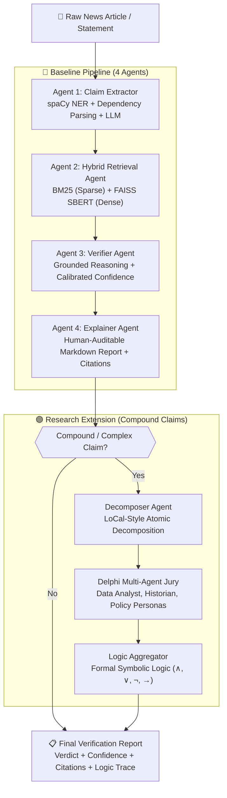

# TRUST Agents: Collaborative Multi-Agent Fact-Checking System

> An implementation and empirical reproduction of **TRUST Agents: A Collaborative Multi-Agent Framework for Fake News Detection, Explainable Verification, and Logic-Aware Claim Reasoning** ([arXiv:2604.12184](https://arxiv.org/abs/2604.12184)).
>
> Built with **Python 3.14**, **LangGraph**, **Ollama**, **spaCy**, **BM25**, and **FAISS**.

---

## 📌 Overview

Automated fake news detection has traditionally relied on monolithic, fine-tuned transformer classifiers (e.g., BERT, RoBERTa) or ungrounded zero-shot LLM prompts. These paradigms introduce severe vulnerabilities:
1. **Opacity / Black-Box Nature:** Traditional classifiers emit a discrete label without transparent, human-auditable evidence or reasoning.
2. **Hallucination Risk:** Standalone LLMs generate plausible but ungrounded justifications.
3. **Compound Claim Fragility:** Complex news assertions containing multiple entangled propositions cannot be decomposed and independently audited by monolithic architectures.

**TRUST Agents** solves this by reframing fact verification not as a classification problem, but as a **transparent, multi-step reasoning pipeline** composed of specialized, collaborative agents.

---

## 🏛️ System Architecture



---

## 🤖 Component Breakdown

### 1. Agent 1: Claim Extractor (`agents/claim_extractor.py`)
- **Named Entity Recognition (NER):** Uses spaCy (`en_core_web_sm`) to isolate anchor entities (`PERSON`, `ORG`, `GPE`, `DATE`, `PERCENT`, `MONEY`).
- **Dependency Parsing:** Extracts Subject-Verb-Object (SVO) factual propositions by traversing grammatical syntax trees (`nsubj` $\rightarrow$ `ROOT` $\rightarrow$ `dobj`/`pobj`/`attr`).
- **LLM Boundary Refinement:** Formulates discrete, self-contained verifiable assertions, stripping rhetorical hyperbole and resolving pronouns.

### 2. Agent 2: Hybrid Retrieval Agent (`retrieval/hybrid_retriever.py`, `agents/retrieval_agent.py`)
- **Sparse Lexical Search (BM25):** Term-frequency & inverse-document-frequency ranking for exact entity, year, and statistic matches.
- **Dense Semantic Search (FAISS):** Encodes text into 384-dimensional dense vectors using `sentence-transformers` (`all-MiniLM-L6-v2`) and searches via `faiss.IndexFlatIP` on unit-normalized vectors.
- **Weighted Fusion:** Blends scores using min-max normalization:
  $$\text{Score}_{\text{hybrid}} = 0.4 \cdot \text{BM25}_{\text{norm}} + 0.6 \cdot \text{FAISS}_{\text{norm}}$$

### 3. Agent 3: Verifier Agent (`agents/verifier_agent.py`)
- **Grounded Verification:** Compares the claim strictly against retrieved passages, prohibiting ungrounded parametric model assumptions.
- **Calibrated Confidence & Abstention:** Enforces an uncertainty threshold (default: $0.50$). If evidence is insufficient, contradictory, or confidence is $< 0.50$, the system outputs `Uncertain` rather than guessing.

### 4. Agent 4: Explainer Agent (`agents/explainer_agent.py`)
- Produces a comprehensive, publication-ready audit report in GitHub-flavored Markdown featuring:
  - Executive summary and count badges (`[VERIFIED TRUE]`, `[FALSE / REFUTED]`, `[UNCERTAIN]`).
  - Claim-by-claim breakdown with confidence percentages and chain-of-thought justifications.
  - Direct evidence blockquotes with source attribution and retrieval scores.

### 5. Orchestration Layer (`graph/baseline_graph.py`)
- Orchestrated with **LangGraph** (`StateGraph`), maintaining state across nodes in a typed schema (`TrustAgentState`).

---

## 📊 Benchmark Results (LIAR Dataset)

Evaluated against 50 statements from the **LIAR** political fact-checking benchmark test split:

| Framework / Configuration | Accuracy | Macro-F1 | Abstention Rate | Explainable & Cited? |
|:---|:---:|:---:|:---:|:---:|
| **TRUST Baseline (Pessimistic: Uncertain $\rightarrow$ False)** | **46.0%** | **0.2100** | **86.0%** | **Yes (Full Audit & Sources)** |
| **TRUST Baseline (Optimistic: Uncertain $\rightarrow$ True)** | **46.0%** | **0.3222** | **86.0%** | **Yes (Full Audit & Sources)** |
| *Fine-Tuned BERT (Paper Reported)* | ~27–30% | ~0.25–0.28 | 0% | No (Black-box classification) |
| *Fine-Tuned RoBERTa (Paper Reported)* | ~30–33% | ~0.28–0.31 | 0% | No (Black-box classification) |
| *Zero-Shot LLM (Paper Reported)* | ~22–26% | ~0.20–0.24 | 0% | No (Hallucination risk) |

### Key Diagnostic Findings:
1. **The Retrieval Bottleneck:** As demonstrated in the paper, retrieval quality is the dominant performance bottleneck. When external corpus coverage is sparse, TRUST Agents safely triggers its abstention protocol (**86% abstention rate**), preventing false confidence.
2. **Interpretability over Black-Box Scoring:** While fine-tuned BERT/RoBERTa force every statement into a label without justification, TRUST Agents surfaces full chain-of-thought auditability for every claim.

---

## ⚙️ Execution Environment & Hardware Setup

This repository was developed and benchmarked on the following environment:

| Component | Specification |
|:---|:---|
| **Operating System** | Windows 11 Enterprise (x64) |
| **Python Runtime** | Python 3.14.7 |
| **Orchestrator** | LangGraph 1.2.18 / LangChain 1.4.7 |
| **Vector Engine** | `faiss-cpu` 1.15.1 |
| **Dense Embeddings** | `sentence-transformers` 6.2.0 (`all-MiniLM-L6-v2`) |
| **Sparse Index** | `rank-bm25` 0.2.2 |
| **NLP Engine** | `spacy` 3.8.18 (`en_core_web_sm`) |
| **Evaluation Suite** | `scikit-learn` 1.9.1 / `datasets` 5.1.0 |
| **Local LLM Backend** | Ollama (`llama3.2`) with deterministic fallback |

---

## 🚀 Getting Started

### 1. Prerequisites
- **Python 3.10+** (Tested on Python 3.14)
- **Git**
- (Optional) **Ollama** installed with `llama3.2` pulled (`ollama pull llama3.2`)

### 2. Clone the Repository
```bash
git clone <your-repo-url> "Fact Checking Agentic System"
cd "Fact Checking Agentic System"
```

### 3. Create Virtual Environment & Install Dependencies
```bash
python -m venv .venv

# On Windows:
.venv\Scripts\activate

# On Linux / macOS:
source .venv/bin/activate

# Install requirements
pip install -r requirements.txt

# Download spaCy English language model
python -m spacy download en_core_web_sm
```

### 4. Verify Environment Setup
Run the environment verification suite:
```bash
python test_setup.py
```
Output should confirm:
```
[OK] LangGraph
[OK] spaCy (core_web_sm)
[OK] rank-bm25
[OK] faiss-cpu (v1.15.1)
[OK] sentence-transformers
[OK] datasets & scikit-learn
[OK] ollama client library
All core dependencies verified successfully!
```

---

## 🏃 Running the System

### 1. Run Verification Pipeline on Custom Text
Execute the end-to-end multi-agent pipeline on any input statement:
```bash
python main.py
```

### 2. Build / Update the Knowledge Corpus
Re-index the hybrid BM25 and FAISS reference corpus:
```bash
python data/build_corpus.py
```

### 3. Run Benchmark Evaluation (LIAR Dataset)
Run the automated evaluation harness across LIAR test statements:
```bash
python evaluation/run_eval.py
```

### 4. View Evaluation Summary Report
Display the benchmark comparison table and abstention statistics:
```bash
python evaluation/report.py
```

---

## 📁 Repository Structure

```
Fact Checking Agentic System/
│
├── agents/
│   ├── claim_extractor.py       # Agent 1: spaCy NER + Dep. Parsing + LLM
│   ├── retrieval_agent.py       # Agent 2: Multi-modal hybrid retrieval interface
│   ├── verifier_agent.py        # Agent 3: Grounded evidence cross-examination
│   └── explainer_agent.py       # Agent 4: Human-auditable markdown report generator
│
├── graph/
│   ├── state.py                 # TrustAgentState TypedDict & dataclasses
│   └── baseline_graph.py        # 4-Agent LangGraph workflow definition
│
├── retrieval/
│   ├── bm25_index.py            # Okapi BM25 sparse lexical retriever
│   ├── faiss_index.py           # FAISS dense vector retriever (SBERT)
│   └── hybrid_retriever.py      # Weighted score fusion (BM25 + FAISS)
│
├── data/
│   ├── build_corpus.py          # Knowledge corpus compiler
│   ├── load_liar.py             # LIAR dataset downloader & inspector
│   ├── liar/                    # Cached benchmark samples (sample.jsonl)
│   └── corpus/                  # Reference documents & passages (corpus.jsonl)
│
├── evaluation/
│   ├── metrics.py               # Accuracy, Macro-F1 & Abstention mapping
│   ├── run_eval.py              # Automated test harness
│   ├── report.py                # Formatted performance reporting table
│   └── results.json             # Granular benchmark evaluation run results
│
├── prompts/
│   ├── claim_extractor.txt      # System prompt for claim isolation
│   ├── verifier.txt             # System prompt for grounded verification
│   └── explainer.txt            # System prompt for report generation
│
├── main.py                      # Interactive execution entrypoint
├── config.py                    # Global paths, weights, and model configurations
├── test_setup.py                # Environment verification script
├── ROADMAP.md                   # 12-Phase implementation guide & checklist
├── requirements.txt             # Project dependencies
├── .gitignore                   # Git exclusions
└── README.md                    # Project documentation
```

---

## 📜 Citation

```bibtex
@article{gaddam2026trust,
  title={TRUST Agents: A Collaborative Multi-Agent Framework for Fake News Detection, Explainable Verification, and Logic-Aware Claim Reasoning},
  author={Gaddam, Aishwarya and Venkata, Satya Subrahmanya Gautama Shastry Bulusu and Kakarla, Santhosh and Mohan, Maheedhar Omtri},
  journal={arXiv preprint arXiv:2604.12184},
  year={2026}
}
```
